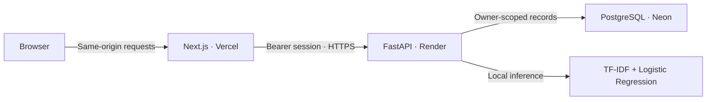

# Smart Ticket AI

**Machine learning–assisted triage for a private support workspace.**

[](https://github.com/Marco-aq/smart-ticket-ai/actions/workflows/ci.yml)

Smart Ticket AI classifies English support requests by department and priority, then lets each account manage its own queue. It combines a documented scikit-learn training pipeline, a FastAPI inference service, PostgreSQL persistence, and a responsive Next.js dashboard.

**Project status:** implemented and prepared for **manual deployment**. A public demo URL has not been configured. Use synthetic tickets only; the model is an educational baseline rather than an operational incident-triage system.

[Quick start](#quick-start) · [Architecture](#architecture) · [Model evaluation](#model-evaluation) · [Deployment guide](docs/DEPLOYMENT.md) · [Model card](docs/MODEL_CARD.md) · [Engineering decisions](docs/CASE_STUDY.md)

## Problem and solution

Support requests arrive as unstructured text. Categorizing them manually adds repetitive work before an agent can investigate the issue. Smart Ticket AI demonstrates an end-to-end alternative: suggest a queue and priority, expose model scores, and keep a person responsible for the final decision.

The project goes beyond a prediction endpoint: authentication, owner-scoped persistence, search, pagination, lifecycle updates, deletion, and aggregate statistics turn the classifiers into a usable application.

## Features

| Area | Implemented behavior |
| --- | --- |
| Public classifier | Analyze a fictional English request without saving its text to the application database |
| Private workspace | Provisioned accounts, login, eight-hour sessions, and server-side logout revocation |
| Ticket creation | Predict category and priority, require a synthetic-data declaration, and save to the current account |
| Ticket history | Subject search, priority/status filters, and server-side pagination |
| Ticket details | Description, predictions, model scores, status updates, and confirmed permanent deletion |
| Analytics | Total tickets, suggested reviews, review rate, and category/priority/status distributions for the account |
| Responsive interface | Desktop sidebar, mobile navigation, loading/error/empty states, and retry controls |
| Data handling | Public demo policy, account deletion, password resets, and a retention-cleanup command |
| Delivery | Docker runtime, environment templates, automated verification, and manual Render/Vercel instructions |

## Architecture



Next.js acts as a backend-for-frontend at `/api/backend/*`. It keeps the session token in a server-set HttpOnly cookie and forwards authorized requests to FastAPI. The API validates the session and scopes ticket queries and statistics to the account. The trained models load once at API startup.

| Layer | Technology | Responsibility |
| --- | --- | --- |
| Interface | Next.js 16, React 19, TypeScript, Tailwind CSS, Lucide | Pages, forms, navigation, and feedback |
| Session boundary | Next.js Route Handler | Same-origin proxy, HttpOnly cookie, mutation-origin checks |
| API | Python 3.11, FastAPI, Pydantic | Validation, inference, authentication, and ticket operations |
| Machine learning | scikit-learn 1.9.1, joblib | Two TF-IDF + Logistic Regression pipelines |
| Persistence | SQLAlchemy, psycopg, PostgreSQL | Accounts, hashed sessions, and owner-scoped tickets |
| Local database | SQLite | Development and isolated browser tests |
| Verification | pytest, Playwright, ESLint, GitHub Actions | API, permissions, PostgreSQL, browser flow, build, and container checks |
| Packaging | Docker | Non-root API process and inference-only dependency set |

## Quick start

### Prerequisites

- Python **3.11** for parity with Docker and CI.
- Node.js **24.x**, npm, and Git.
- Docker only if you want to test the container locally.
- Neon/PostgreSQL for deployment; SQLite is sufficient to explore locally.

The commands below use **Windows PowerShell**. Run them from the repository root unless a different directory is shown.

### 1. Get the current code

For a new checkout:

```powershell
git clone https://github.com/Marco-aq/smart-ticket-ai.git
cd smart-ticket-ai
```

For an existing checkout, save any local work first, then update without rewriting history:

```powershell
git status
git fetch origin
git switch main
git pull --ff-only origin main
git log -1 --oneline
```

`Already up to date` means your checkout already has the latest commit. Updating Git does **not** start the application. If Git reports local changes or diverging branches, resolve that message before continuing; do not use a hard reset to discard work.

### 2. Start the backend

```powershell
cd backend
py -3.11 -m venv .venv
.\.venv\Scripts\Activate.ps1
python -m pip install -r requirements.txt
if (!(Test-Path .env)) { Copy-Item .env.example .env }
python -m app.manage init-db
python -m app.manage create-user --username marco
python -m uvicorn app.main:app --reload
```

The default `.env` creates a local SQLite database. Choose a unique password of **12–256 characters** at the hidden prompt. If the account already exists, keep using it or run `reset-password`; do not recreate it. Configuration-copy commands preserve existing `.env` files.

The two trusted model artifacts are already included. You do not need to download data or retrain to run the application.

### 3. Start the frontend

Open a second PowerShell terminal at the repository root:

```powershell
cd frontend
npm ci
if (!(Test-Path .env.local)) { Copy-Item .env.example .env.local }
npm run dev
```

Open **http://localhost:3000**. Keep that exact hostname: the browser origin must match `APP_ORIGIN`. FastAPI's interactive API documentation is at **http://localhost:8000/docs**.

### 4. Try the workflow

1. On the overview page, use the fictional example and classify it without saving.
2. Sign in using the account you provisioned.
3. Create a fictional ticket, confirm the data declaration, and open its detail.
4. Change its status, find it through history, and inspect the analytics.
5. Delete the test ticket and sign out.

## Configuration

| Variable | Location | Local example | Deployment |
| --- | --- | --- | --- |
| `DATABASE_URL` | Backend only | `sqlite:///./smart_ticket.db` | Neon URL with `postgresql+psycopg://` and its TLS options |
| `ENVIRONMENT` | Backend only | Unset for development | `production`; rejects a non-PostgreSQL configuration |
| `ALLOWED_ORIGINS` | Backend only | `http://localhost:3000` | Exact allowed frontend origins, separated by commas |
| `PORT` | Backend process | `8000` | Hosting-provided port; Docker binds on `0.0.0.0` |
| `API_URL` | Next.js server only | `http://localhost:8000` | Backend HTTPS origin |
| `APP_ORIGIN` | Next.js server only | `http://localhost:3000` | Exact browser origin, with no trailing slash |
| `NEXT_TELEMETRY_DISABLED` | Frontend tooling | `1` | `1` |

Templates: [backend/.env.example](backend/.env.example) and [frontend/.env.example](frontend/.env.example). The old `NEXT_PUBLIC_API_URL` is no longer used. No database password or session token belongs in a `NEXT_PUBLIC_` variable.

## Application and API

| Page | Purpose |
| --- | --- |
| `/` | Project overview and public classifier |
| `/login` | Login for provisioned accounts |
| `/tickets/new` | Classify and save a fictional request |
| `/tickets` | Searchable, filtered, paginated history |
| `/tickets/[id]` | Detail, status updates, and deletion |
| `/analytics` | Account-level queue statistics |
| `/privacy` | Demo data policy and limitations |

| Method | API route | Access / behavior |
| --- | --- | --- |
| GET | `/health` | Public process/model health; does not check PostgreSQL |
| POST | `/predict` | Public prediction; does not persist ticket text |
| POST | `/auth/login` | Username/password → opaque bearer session |
| GET | `/auth/me` | Current authenticated account |
| POST | `/auth/logout` | Revoke the current session |
| POST | `/tickets` | Authenticated creation; requires `synthetic_data_confirmed: true` |
| GET | `/tickets` | Own history: `q`, `priority`, `status`, `page`, `page_size` |
| GET | `/tickets/{id}` | Own ticket detail; another account's ticket returns 404 |
| PATCH | `/tickets/{id}` | Own status: `open`, `in_progress`, or `resolved` |
| DELETE | `/tickets/{id}` | Permanently delete an owned ticket |
| GET | `/analytics` | Aggregates over all of the account's tickets |

Example public API request, suitable for Swagger:

```json
{
  "subject": "Fictional duplicate payment",
  "description": "A synthetic account was billed twice for a fictional subscription. Please investigate this test transaction."
}
```

The response contains `category`, `category_score`, `priority`, `priority_score`, and `needs_review`. For direct API clients, pass the login token as `Authorization: Bearer <token>`. Browser clients use the same-origin proxy; the token is not returned to frontend JavaScript.

## Model evaluation

Each target uses an independent pipeline: **TF-IDF → Logistic Regression**. This provides a fast, CPU-friendly baseline and packages preprocessing together with prediction.

The training script filters English tickets, combines `subject` and `body`, removes exact duplicate text, selects the eight most frequent queues, and uses an 80/20 train/test split with `random_state=42`, stratified by queue. Agent responses are excluded from model inputs.

The committed [metrics.json](backend/models/metrics.json) reports:

| Target | Accuracy | Macro-F1 |
| --- | ---: | ---: |
| Department / queue | 55.19% | 0.5656 |
| Priority | 65.22% | 0.6434 |

These are **existing saved evaluation results**, not a new evaluation performed during deployment preparation. They indicate an initial baseline with substantial room for improvement. They do not establish real-world performance or superiority over a majority-class baseline; that comparison and a persisted confusion matrix are still pending.

A score below **0.60** for either target flags the request for human review. Scores are **not calibrated probabilities**, and the review threshold has not been optimized against a business cost function.

See the [model card](docs/MODEL_CARD.md) for exact labels, provenance, evaluation limitations, and intended use. To rerun training from the full development environment:

```powershell
cd backend
.\.venv\Scripts\Activate.ps1
python -m ml.train
```

Training downloads the dataset and **replaces** the model artifacts and metrics. Preserve the current artifacts before experimenting. The dataset download currently follows the source's default revision; exact data-version reproducibility requires pinning a revision.

## Security and data handling

- Passwords use **Argon2**; public account registration is disabled.
- Session tokens are random and opaque. Only their SHA-256 hashes are stored, with an eight-hour expiry. Logout revokes the session; password resets revoke all sessions for that account.
- The browser cookie is **HttpOnly**, **SameSite=Strict**, and **Secure in production**. Mutations through the frontend require a matching request origin.
- Ownership is enforced in the API for reads, writes, deletion, and aggregates. Hiding dashboard controls is not the authorization boundary.
- Rate limits are 5 logins/minute, 10 public predictions/minute, 20 ticket creations/minute, and a default 120 requests/minute for other API operations.
- The limiter is process-local and the container runs **one worker**. Proxies can cause users to share a network bucket. Multi-instance operation requires a shared store and a verified trusted-proxy policy.
- Local environment files, private keys, databases, SQL dumps, caches, and test reports are excluded from Git. The Docker context uses an allowlist and further excludes private material from allowed application folders.
- Tickets are accepted on the declaration that they are synthetic. That declaration does not automatically detect or redact personal data. Hosting providers can retain connection metadata and backups.

Use this demo with fictional data. A deployment handling real personal information requires an owner-specific privacy notice and operational data-handling controls.

## Verification

Run API tests from `backend`, then frontend checks from `frontend`, with the Python environment still active:

```powershell
cd backend
python -m pytest -q
cd ../frontend
npm run lint
npm run build
npx playwright install chromium
npm run test:e2e
```

| Check | Coverage |
| --- | --- |
| API / security tests | Validation, login, session hashing/expiry/revocation, account isolation, search/filter/page behavior, deletion, and rate limits |
| PostgreSQL integration | Login and the ticket lifecycle against a dedicated test database in CI |
| Browser test | Public inference, login, creation, status, search, pagination, analytics, two accounts, CSRF rejection, mobile layout, deletion, and logout |
| Frontend checks | ESLint, TypeScript through the production build, and page compilation |
| Container checks | Image build, startup, real-model prediction, protected routes, and exclusion of training/test packages and private files |

Without `TEST_DATABASE_URL`, the PostgreSQL integration test is skipped locally. Browser tests create temporary SQLite data and test-only accounts; they do not require your Neon credentials. PostgreSQL tests accept only a dedicated local database with a name ending in `_test`.

[GitHub Actions](https://github.com/Marco-aq/smart-ticket-ai/actions) performs these checks on pull requests and on `main`. It does not publish a website or container image.

## Deployment

Follow the **[manual deployment guide](docs/DEPLOYMENT.md)** for Neon → Render → Vercel, including account provisioning and post-deployment checks.

| Service | Deployable unit | Required preparation |
| --- | --- | --- |
| Neon | PostgreSQL | Private connection URL, initialize schema, provision an account |
| Render | `backend/Dockerfile`, build context `backend` | Production database URL, allowed origins, `/health`, manual deploy setting |
| Vercel | Project root `frontend` | `API_URL`, `APP_ORIGIN`, Node.js 24.x |

`frontend/vercel.json` disables automatic Git-triggered deployments; publish explicitly when ready. Configure Render's auto-deploy setting separately. Repository readiness does not provision accounts, purchase services, or publish the app. Hosting plans and quotas must be checked when you deploy.

For local Docker verification with a PostgreSQL URL in `backend/.env`:

```powershell
docker build -t smart-ticket-api ./backend
docker run --rm -p 8000:8000 --env-file backend/.env smart-ticket-api
```

The image installs [requirements-runtime.txt](backend/requirements-runtime.txt), includes the two trusted models, and runs as a non-root user. It excludes the training pipeline, dataset clients, and test suite. SQLite inside this image is not a supported persistence configuration.

## Maintenance and project structure

From `backend` with the correct `.env`:

```powershell
python -m app.manage reset-password --username marco
python -m app.manage purge-expired
python -m app.manage delete-user --username marco
```

The purge command deletes expired sessions and tickets older than 30 days; run or schedule it yourself. No retention scheduler is enabled. Account deletion requires confirmation. `init-db` creates the initial schema and preserves an older unowned `tickets` table without exposing its contents. Future schema changes need versioned migrations.

| Path | Contents |
| --- | --- |
| `backend/app/` | API, persistence, authentication, and administration CLI |
| `backend/ml/train.py` | Dataset preparation and model training |
| `backend/models/` | Trusted model artifacts and saved metrics |
| `backend/tests/` | API, security, PostgreSQL, and isolated browser-server setup |
| `frontend/src/app/` | Pages and same-origin API proxy |
| `frontend/src/components/` | Workspace shell, forms, list/detail, and analytics |
| `frontend/e2e/` | Full browser workflow |
| `scripts/smoke_api.py` | Non-writing checks against a running packaged API |
| `docs/` | Deployment guide, model card, and engineering case study |
| `.github/workflows/ci.yml` | Verification pipeline |

## Dataset attribution and licensing

Training source: [vasu1111/customer-support-tickets](https://huggingface.co/datasets/vasu1111/customer-support-tickets), file `aa_dataset-tickets-multi-lang-5-2-50-version.csv`. The dataset card identifies the **CC BY-NC 4.0** license and links to Tobias Bueck's Open Ticket AI work. See [the dataset card](https://huggingface.co/datasets/vasu1111/customer-support-tickets/blob/main/README.md) and [license terms](https://creativecommons.org/licenses/by-nc/4.0/) for attribution and use conditions. The English subset is filtered and vectorized to train the bundled artifacts; this project is presented as a noncommercial portfolio demo.

A project-wide software license has not been declared. Dataset licensing and third-party dependency licenses remain separate from the application code.

## Next improvements

- Compare against a majority-class baseline and persist per-class metrics and confusion matrices.
- Pin dataset revisions and record training provenance alongside artifact versions.
- Group near-duplicate tickets before splitting to reduce leakage risk.
- Calibrate scores and choose review thresholds on a separate validation set.
- Add human label corrections and evaluate retraining from reviewed examples.
- Introduce versioned schema migrations and a shared rate-limit store before scaling.
- Add Spanish only after training and evaluating on suitable Spanish data.
